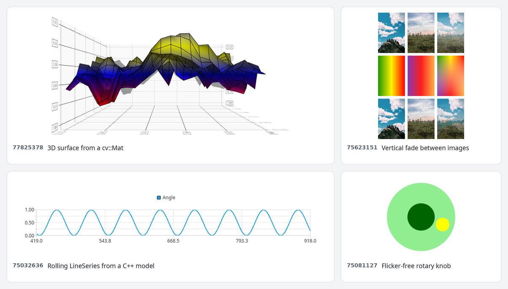

# Stack Overflow answers

Small, self-contained Qt/QML projects behind my answers on
[Stack Overflow](https://stackoverflow.com/users/525038). Each folder is named after the
question ID and has a README with a summary of the question, my answer, and how to
build the code.



| Folder | Question | Topic | Qt | Accepted |
| --- | --- | --- | --- | :---: |
| [74885512](questions/74885512) | [Qt Select At Most 1 Marker on Map](https://stackoverflow.com/questions/74885512/qt-select-at-most-1-marker-on-map) | Single selection for map markers (ListModel role, index property, ItemSelectionModel) | 6.5 | ✓ |
| [75032636](questions/75032636) | [Continuously update a QML LineSeries ChartView with a data model from C++](https://stackoverflow.com/questions/75032636/continuously-update-a-qml-lineseries-chartview-with-a-data-model-from-c) | Rolling LineSeries fed by a QAbstractTableModel through VXYModelMapper | 6.5 | ✓ |
| [75060420](questions/75060420) | [How to prevent lupdate to remove some entrie from my translation files?](https://stackoverflow.com/questions/75060420/how-to-prevent-lupdate-to-remove-some-entrie-from-my-translation-files) | Keeping manual .ts entries with lupdate (lconvert, QT_TR_NOOP) | 6.5 | ✓ |
| [75067972](questions/75067972) | [Is there a way to create qml filedialog with specific localization settings?](https://stackoverflow.com/questions/75067972/is-there-a-way-to-create-qml-filedialog-with-specific-localization-settings) | Showing a QML FileDialog in another language with the qtbase translations | 6.5 | ✓ |
| [75069400](questions/75069400) | [How to do QObject::connect to QJSValue?](https://stackoverflow.com/questions/75069400/how-to-do-qobjectconnect-to-qjsvalue) | Connecting a C++ signal to a QML function | 6.5 |  |
| [75081127](questions/75081127) | [QT QML rectangle flickers when rotated by mouse](https://stackoverflow.com/questions/75081127/qt-qml-rectangle-flickers-when-rotated-by-mouse) | Rotary knob that rotates without flickering (vector angle maths) | 6.5 | ✓ |
| [75085103](questions/75085103) | [Create an empty QStringList directly in a QML file](https://stackoverflow.com/questions/75085103/create-an-empty-qstringlist-directly-in-a-qml-file) | Passing a JavaScript array or `list<string>` as a `QStringList` | 6.5 |  |
| [75595411](questions/75595411) | [QML Item cliping shadow ShaderEffect](https://stackoverflow.com/questions/75595411/qml-item-cliping-shadow-shadereffect) | Drop shadow with ShaderEffect that is not clipped by the source item | 6.5 | ✓ |
| [75623151](questions/75623151) | [Vertical fade and different color on horizontal](https://stackoverflow.com/questions/75623151/vertical-fade-and-different-color-on-horizontal) | Blending images or gradients with a vertical fade (OpacityMask vs. fragment shader) | 6.5 | ✓ |
| [76248716](questions/76248716) | [QML PolarChart point label on hover](https://stackoverflow.com/questions/76248716/qml-polarchart-point-label-on-hover) | Tooltip for the hovered point in a ChartView / PolarChartView (Qt 5.15) | 5.15 | ✓ |
| [76291145](questions/76291145) | [In QML, I cannot get a shortcut for a CheckBox](https://stackoverflow.com/questions/76291145/in-qml-i-cannot-get-a-shortcut-for-a-checkbox) | Checkable menu entry with a working mnemonic shortcut | 6.5 | ✓ |
| [76685924](questions/76685924) | [How to change map.activeMapType at the app startup?](https://stackoverflow.com/questions/76685924/how-to-change-map-activemaptype-at-the-app-startup) | Setting the initial map type of a MapView at startup (OSM providers repository) | 6.5 | ✓ |
| [77687596](questions/77687596) | [Return QJSValue from C++ to qml](https://stackoverflow.com/questions/77687596/return-qjsvalue-from-c-to-qml) | Returning a JavaScript array as QJSValue from C++ (use the QML engine) | 6.5 | ✓ |
| [77825378](questions/77825378) | [Binding QML ItemModelSurfaceDataProxy wiht a C++ model in Qt](https://stackoverflow.com/questions/77825378/binding-qml-itemmodelsurfacedataproxy-wiht-a-c-model-in-qt) | 3D surface from a `cv::Mat` with a custom `QSurfaceDataProxy` | 6.5 | ✓ |
| [77967427](questions/77967427) | [Qt6: Warnings when QML Listview accesses C++ model](https://stackoverflow.com/questions/77967427/qt6-warnings-when-qml-listview-accesses-c-model) | `QList<QObject*>` property as a ListView model (`QML_SINGLETON`, `QML_ELEMENT`) | 6.5 | ✓ |
| [79711085](questions/79711085) | [QML + OSM: Loading Offline Tiles from Local Drive](https://stackoverflow.com/questions/79711085/qml-osm-loading-offline-tiles-from-local-drive) | Offline OSM tiles for QtLocation (zoom level limits) | 6.8 |  |

## Building

Except for [76248716](questions/76248716) (qmake, Qt 5.15), every folder is a
standalone CMake project:

```bash
cd questions/<id>
cmake -S . -B build -DCMAKE_PREFIX_PATH=~/Qt/6.x/gcc_64
cmake --build build
```

Each folder's README lists the Qt modules it needs.

The code in a folder can differ slightly from the answer: some folders contain the
complete project behind a shorter answer, and the code has been updated to build
without warnings on current Qt 6.
